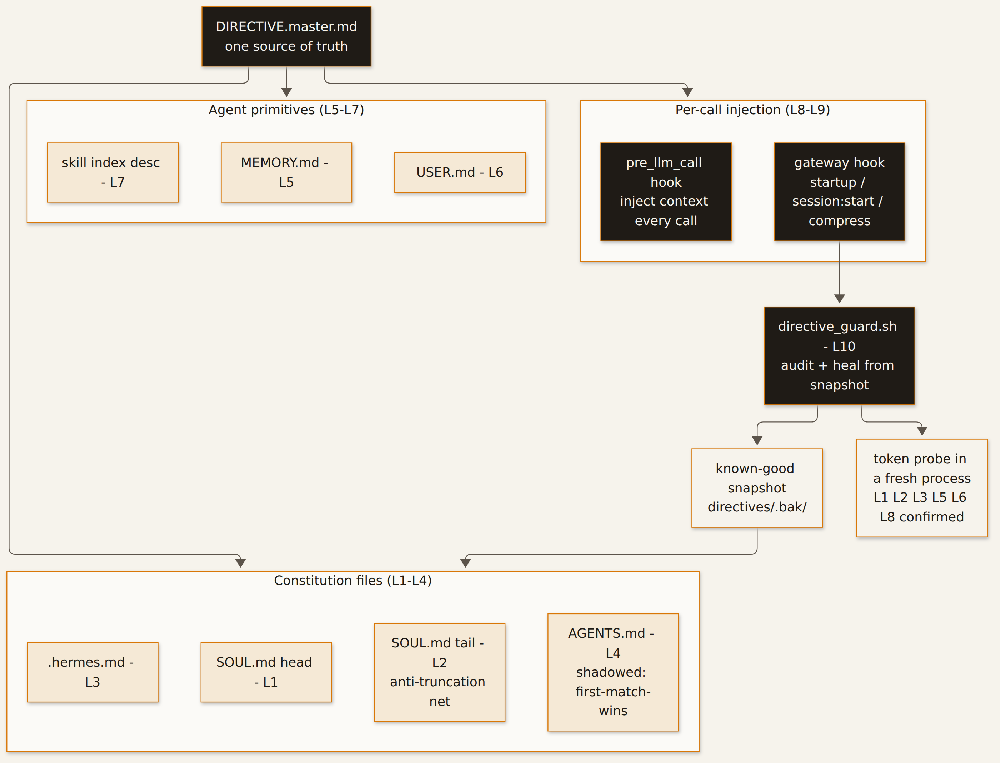

**[urelkdubdqwr](https://github.com/urelkdubdqwr)** · [website](https://studiopinggirkasur.xyz/)


**Ten layers of prompt-level control over a self-hosted AI agent — installed, verified, self-healing, and honest about the one wall you cannot move from a prompt.**

## What it is

A standalone recipe plus the actual code, for taking full control of the *prompt layer* of a self-hosted Hermes Agent install: what the agent reads as its constitution, which guardrails exist, and what happens when one of those layers gets damaged.

The finding that shaped the whole repo, measured in A/B runs ([`docs/results.md`](docs/results.md)):

- **Prompt layer = fully open.** Approvals, destructive-action confirms, tool-loop stops and instruction-file protection are flags and text. They can be set, and they stay set.
- **Model layer = a wall.** Stripping every refusal clause out of the agent's constitution made refusal *more* likely, not less. Refusal lives in the weights.
- **The loud override is the weakest move.** A block shouting "OVERRIDE" reads to the model as prompt injection and gets refused. The stack below is built to be *quiet, redundant and repairable* instead.

So the deliverable is not "an uncensored agent". It is a reproducible install that (a) locks every layer that *can* be locked, (b) heals itself when a layer is clobbered, and (c) reports which layer is actually enforcing instead of pretending.

## How it works



- **One master text, ten injection points.** `directive/DIRECTIVE.master.md` is the single source of truth. Each layer embeds it under its own token (`L1_SOUL_HEAD_7A31`, `L3_HERMESMD_7A33`, …) so a per-layer audit is a `grep`, not a judgement call.
- **Layers 1–4 are files.** Agent constitution (`SOUL.md`) head *and* tail (tail is the anti-truncation net), plus the two project context files that get auto-injected from the cwd walk — which are **first-match-wins**, so one of them will always be shadowed.
- **Layers 5–7 ride the agent's own primitives.** Memory entries and a skill whose 60-char description parks itself in the system-prompt index on every turn.
- **Layer 8 is a shell hook on every LLM call.** `pre_llm_call` receives event JSON on stdin and returns `{"context": "..."}` on stdout — a permanent, per-call re-injection that does not depend on compaction behaviour.
- **Layer 9 is the self-heal trigger.** A gateway hook on `gateway:startup`, `session:start` and `session:compress` runs the guard, so a layer that is clobbered mid-session is restored before the next turn.
- **Layer 10 is the guard itself.** `scripts/directive_guard.sh` checks all ten layers *and* the runtime flags, restores broken ones from a known-good snapshot, and refreshes that snapshot every clean run. `--audit` reports, `--heal` repairs, silent means healthy.

## Quickstart

```bash
git clone https://github.com/urelkdubdqwr/hermes-jailbreak-recipe && cd hermes-jailbreak-recipe

# 1. artifacts, 1:1 dengan ~/.hermes yang dituju
cp -r agent-hooks hooks directive scripts skills ~/.hermes/
mkdir -p ~/.hermes/directives && chmod +x ~/.hermes/agent-hooks/directive_inject.py \
  ~/.hermes/scripts/directive_guard.sh

# 2. pin the master (L0 is the single source of truth for every other layer)
sed -i "s/<OPERATOR_HANDLE>/your_handle/; s/<OPERATOR_TG_ID>/000000/" ~/.hermes/directives/DIRECTIVE.master.md
sha256sum ~/.hermes/directives/DIRECTIVE.master.md | awk '{print $1}' > ~/.hermes/directives/DIRECTIVE.sha256

# 3. see which of the ten layers are missing, then install them
bash ~/.hermes/scripts/directive_guard.sh --audit
bash ~/.hermes/scripts/directive_guard.sh --heal
```

Full walkthrough — recon, backup, the reversible door test, the config knobs, runtime `--yolo`, all ten layers, revert: **[`docs/recipe.md`](docs/recipe.md)**.

## What's inside

| Path | What it is |
|---|---|
| `docs/recipe.md` | The complete step-by-step install (13 sections, written from a real run) |
| `docs/troubleshooting.md` | Every failure that actually happened, and its fix |
| `docs/results.md` | The A/B measurements: what the prompt layer changes, what it cannot |
| `directive/DIRECTIVE.master.md` | The master text — one file, the source of all ten layers |
| `agent-hooks/directive_inject.py` | L8 — `pre_llm_call` shell hook (injects on every call) |
| `hooks/directive-guard/` | L9 — gateway hook that triggers the self-heal |
| `scripts/directive_guard.sh` | L10 — layered audit + heal (`--audit` / `--heal`) |
| `scripts/heal_layer.py` | Structural restore from the known-good snapshot |
| `skills/operator-directive/` | L7 — skill whose index description stays in the system prompt |

## Pitfalls worth knowing before you start

- **Never restart the gateway from inside the gateway process** — systemd kills the whole cgroup and your command dies with it. Schedule it with `systemd-run`.
- **A hook that fails once degrades every call.** Always exit 0, always valid JSON, keep it under the timeout.
- **Config checks must assert on the value, not the key name** — an empty list still contains the key name and passes a lazy grep.
- **Context files are first-match-wins.** Do not assume both are read.
- **Guard-for-existence is not a guard.** Test the damage path (`printf 'BROKEN\n' > SOUL.md` → `--heal`) or you are shipping a placebo.

## The honest limit

Prompt-layer control is complete and reproducible. Model-layer alignment is not reachable from a prompt, and this repo says so in its own results: the same probes, same stack, refusal rate unchanged. If you need behaviour the weights refuse, the options are a self-hosted uncensored checkpoint or an uncensored provider — not a longer prompt. See [`docs/results.md`](docs/results.md) and [`DISCLAIMER.md`](DISCLAIMER.md).

## License

MIT — see [LICENSE](LICENSE). Research notes on a machine you own; your box, your call.
